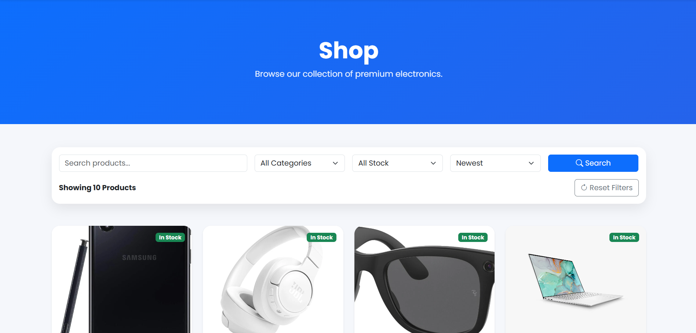
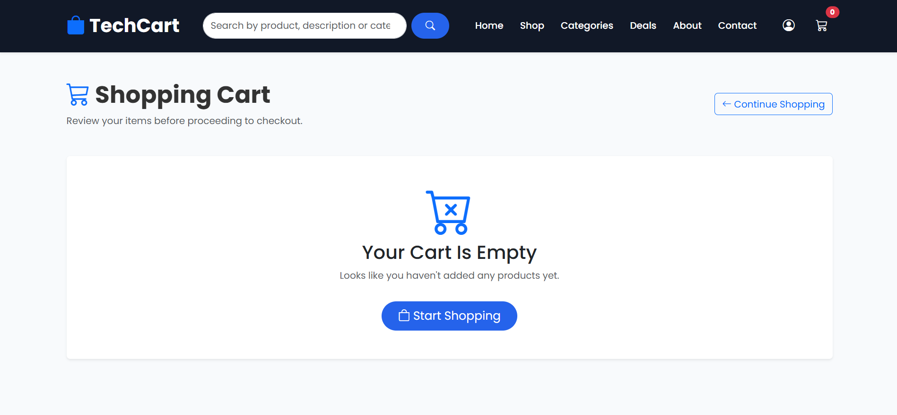
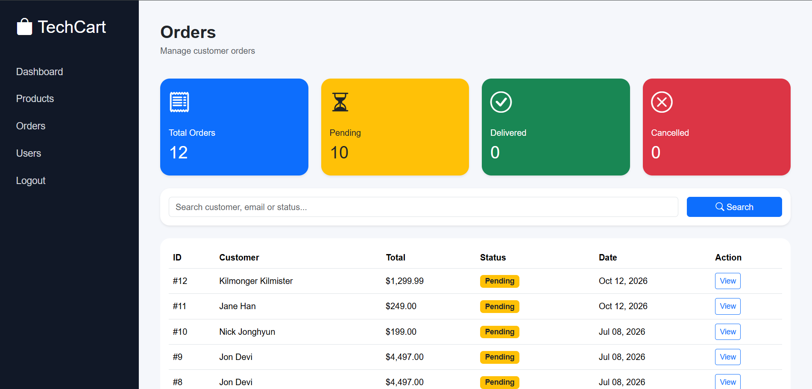
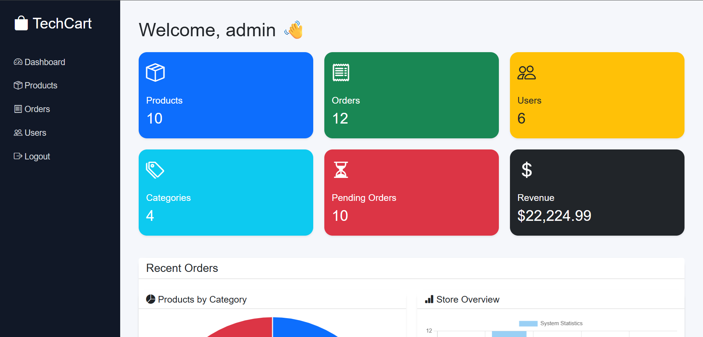
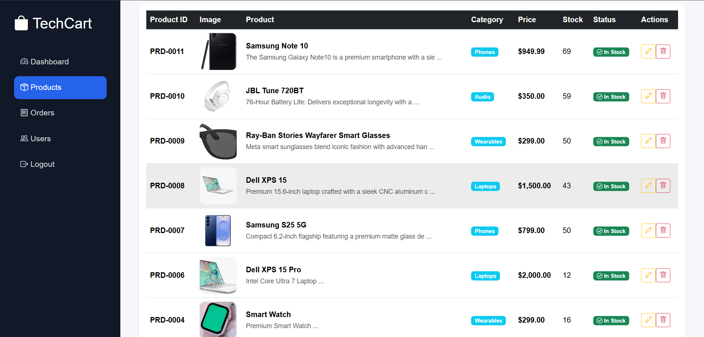

# 🛒 TechCart


A responsive e-commerce web application for electronics, built with **PHP**, **MySQL** and **Bootstrap 5**. Customers can browse and search products, fill a cart, check out and track their orders. An admin panel manages products, orders and customers.

I built it as a portfolio project to practise the full request-to-database flow of a real shop: authentication, sessions, relational data, file uploads, and an order process that stays correct when something goes wrong. It is a **demo store** and takes no real payments.

---

## 📸 Screenshots

<!-- Make sure the file names below match the images in the /screenshots folder. -->

| Home | Shop |
|---|---|
|  |  |

| Product details | Shopping cart |
|---|---|
|  |  |

| Checkout | Order history |
|---|---|
|  |  |

| Admin dashboard | Admin product management |
|---|---|
|  |  |

---

## ✨ Features

### 👤 Customers

- Register, log in and log out (passwords stored with `password_hash`)
- Browse products with **search**, **category** and **stock** filters, and **sorting**
- Product pages with stock status and related products
- **Deals** page for discounted products
- Session-based shopping cart with quantity controls that respect available stock
- Checkout for guests or logged-in customers (details are prefilled when logged in)
- Order confirmation with an order number
- Order history and order details (customers can only see their own orders)
- Edit profile and change password

### 🔐 Administrators

- Separate admin login
- Dashboard with summary statistics, recent orders and charts
- Add, edit and delete products, with an optional discount price
- Image uploads checked for real file type and size
- Order list with search and statistics; per-order page with status updates and a printable invoice
- Customer list with search, and a profile page showing each customer's orders and spending

---

## 🧠 Technical highlights

These are the parts I spent the most time getting right.

- **Placing an order is one database transaction.** Product rows are locked, stock is checked, the order and its items are saved, and stock is reduced with `UPDATE ... WHERE stock >= ?`. If anything fails, everything rolls back, so a failed checkout never leaves a half-created order, and two customers cannot buy the last item at once.
- **Prices come from the database, never from the browser.** The total is calculated on the server at checkout, using the discount price when one is set. The price paid is stored on each order line, so later price changes do not rewrite order history.
- **Safer admin actions.** Deleting a product is a POST request with a CSRF token. The product's image is removed only after the database row is deleted, and products that appear in past orders cannot be deleted.
- **Upload validation.** Uploads are identified from the file's own contents (JPG, PNG or WebP only), must decode as an image, are limited to 2 MB, and are saved under a random name. An `.htaccess` file also blocks scripts from running in the images folder.
- **Session handling.** The session ID is regenerated on login, and login errors do not reveal whether an email exists.
- **Prepared statements** are used in the checkout, order and admin product code, and output is escaped wherever user-entered text is displayed.

---

## ⚠️ Known limitations

I would rather list these than hide them.

- **No payments.** Checkout records an order only. Paystack integration is on the roadmap.
- **Contact and newsletter forms are visual only.** They do not send anything yet.
- **Guest orders are not linked to an account.** They are saved without a user, so they do not appear in "My Orders".
- **Some older read-only queries** (for example search on the shop page) still use escaped strings instead of prepared statements. Moving them over is on the roadmap.
- **Not production-ready.** There is no rate limiting, email verification or password reset, and the cart actions and logout still use plain GET requests.

---

## 🛠 Tech stack

| Area | Tools |
|---|---|
| Frontend | HTML5, CSS3, JavaScript, Bootstrap 5, Bootstrap Icons, Chart.js |
| Backend | PHP 8.1+ (mysqli) |
| Database | MySQL / MariaDB |
| Environment | XAMPP, phpMyAdmin, Visual Studio Code |

---

## 📂 Project structure

```
TechCart/
├── admin/                  Admin panel
│   ├── add_product.php
│   ├── delete_product.php
│   ├── edit_product.php
│   ├── index.php           Dashboard
│   ├── login.php
│   ├── logout.php
│   ├── orders.php
│   ├── products.php
│   ├── users.php
│   ├── view_order.php
│   └── view_user.php
├── assets/
│   ├── css/
│   └── images/             Product images (.htaccess blocks scripts here)
├── config/
│   └── database.php        Database connection
├── database/
│   └── techcart.sql        Schema and sample data
├── includes/
│   ├── functions.php       Shared helpers (escaping, pricing, image uploads)
│   ├── header.php
│   ├── navbar.php
│   └── footer.php
├── screenshots/
├── index.php, shop.php, product.php, categories.php, deals.php
├── cart.php, add_to_cart.php, update_cart.php, remove_from_cart.php, clear_cart.php
├── checkout.php, place_order.php, order_success.php
├── register.php, login.php, logout.php, profile.php, update_profile.php, change_password.php
├── my_orders.php, order_details.php
├── about.php, contact.php, faqs.php, shipping.php, returns.php, privacy.php
└── LICENSE
```

**Database tables:** `users`, `admins`, `categories`, `products`, `orders`, `order_items` (plus an unused `cart` table), linked with foreign keys.

---

## ⚙ Installation

### Requirements

- PHP 8.1 or newer with the `mysqli` and `fileinfo` extensions
- MariaDB 10.4+ or MySQL 5.7+ (developed on XAMPP's MariaDB 10.4)
- Apache 2.4 (XAMPP includes everything above)

### Steps

1. **Clone the repository** into your web root:

   ```
   cd xampp/htdocs
   git clone https://github.com/BenjaminAyivoh1/TechCart.git
   ```

2. **Start Apache and MySQL** from the XAMPP control panel.

3. **Create the database.** In phpMyAdmin, create an empty database named `techcart`.

4. **Import the data.** Select the `techcart` database, choose **Import**, and upload `database/techcart.sql`.

5. **Check the connection settings** in `config/database.php` (the XAMPP defaults are shown):

   ```php
   $host = "localhost";
   $user = "root";
   $password = "";
   $database = "techcart";
   ```

6. **Open the store:** <http://localhost/TechCart>

### Admin panel

The admin login is at <http://localhost/TechCart/admin/login.php>, with the username `admin`.

The sample database ships with a placeholder admin password that is publicly known, so **set your own before anything else**:

1. Generate a hash:

   ```
   php -r "echo password_hash('YourStrongPassword', PASSWORD_DEFAULT);"
   ```

2. Save it in phpMyAdmin (SQL tab), pasting your hash in place of `PASTE_HASH_HERE`:

   ```sql
   UPDATE admins SET password = 'PASTE_HASH_HERE' WHERE username = 'admin';
   ```

Never deploy this project to a public server with the default admin password.

---

## 🔄 How an order flows

```
Browse → Product page → Add to cart → Checkout
      → Server re-prices the cart and checks stock
      → Order + items saved and stock reduced (one transaction)
      → Confirmation page → Order history
```

---

## 🚀 Roadmap

- Paystack integration and GHS pricing
- Prepared statements everywhere
- Require login at checkout, or order lookup for guests
- Password reset and email verification
- Wishlist, product reviews and ratings
- Image gallery per product
- Coupons and discounts
- Sales analytics

---

## 👨‍💻 Author

**Benjamin Ayivoh**
University of Ghana

---

## 🤝 Contributing

Suggestions and feedback are welcome. Feel free to fork the repository and open a pull request.

---

## 📄 License

This project is licensed under the MIT License. See the [LICENSE](LICENSE) file for details.

---

If you found this project useful, a ⭐ on GitHub is appreciated.
